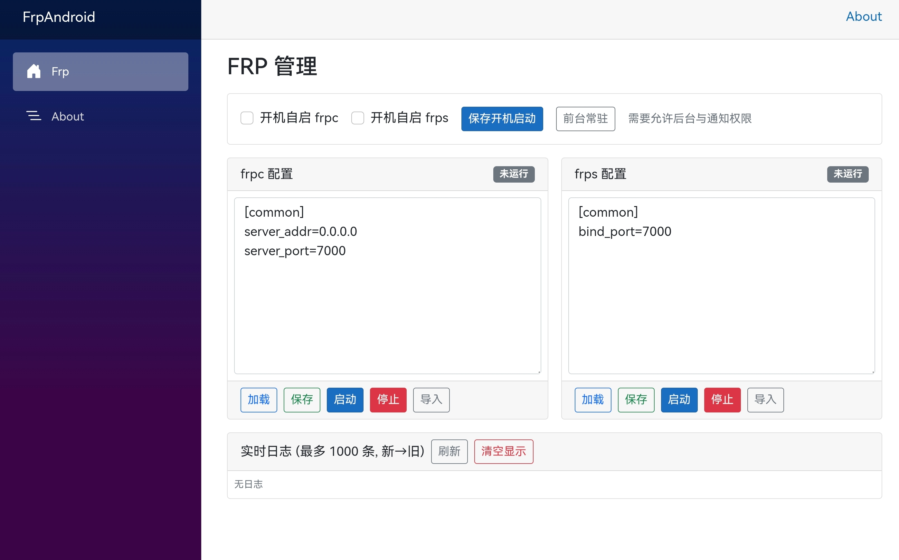

# frp Android 客户端

[](https://github.com/qiuhaotc/frp_android)
[](https://github.com/qiuhaotc/frp_android)
[](https://github.com/qiuhaotc/frp_android)
[](https://github.com/qiuhaotc/frp_android/releases)
[](https://github.com/qiuhaotc/frp_android/releases)
[](https://github.com/qiuhaotc/frp_android)

[English](README_en.md) | 中文文档

基于 .NET MAUI 的轻量级 Android 应用，在手机 / 电视盒子上本地运行与管理 frp，支持同时启动 frpc、frps。



## 功能特性

- 一键启动/停止 frpc 与 frps（构建时下载并内置 frp，安装后无需额外下载；具体版本见 Release 信息）
- 首次运行自动生成 `frpc.toml` / `frps.toml` 默认配置
- 内置配置文件在线编辑与保存
- 实时日志查看（已过滤 ANSI 颜色/控制字符）
- 前台常驻服务，降低被系统回收概率
- 无需 root，体积小，界面简洁

## 快速开始

1. 安装并打开应用
2. 首次启动会在应用数据目录写入默认 `frpc.toml` / `frps.toml`
3. 在应用内编辑配置（示例：为内网服务做穿透）
4. 分别点击启动 frpc 或 frps，查看实时日志确认状态

停止：点击对应停止按钮；若强制结束应用/系统清理后台，隧道将被关闭。

## 构建说明

环境需求：

- .NET 10+（项目含 `net10.0-android` 目标）
- MAUI Android workload：`dotnet workload install maui-android`
- Android SDK / 构建工具（通过 Visual Studio 或命令行安装）
- PowerShell（Windows 使用内置 Windows PowerShell 5.1，其它系统安装 PowerShell 7）与 `tar`
- 能访问 GitHub API 和 Release 下载地址；遇到 API 限流时可设置 `GITHUB_TOKEN` 或 `GH_TOKEN`

在仓库根目录构建（Release 示例；沿用现有签名环境变量及密钥配置）：

```powershell
dotnet build src/FrpAndroid.csproj -c Release -f net10.0-android
```

每次实际 Android 构建都会先查询 [frp 最新稳定 Release](https://github.com/fatedier/frp/releases)，忽略草稿与预发布版本。下载器使用 `android_arm64` 包生成 `arm64-v8a` 库、使用 `linux_arm` 包生成 `armeabi-v7a` 库，从 `frp_sha256_checksums.txt` 验证压缩包 SHA-256，再检查 ELF 架构并重命名为 `libfrpc.so` / `libfrps.so`。

四个库和校验清单缓存在 `src/obj/frp/<版本>/`，同版本且文件校验通过时不会重新下载，但仍会联网检查 Release。检查、下载、校验或解包失败都会中止构建，不回退到旧版本。IDE 的设计时解析和单独的 `dotnet restore` 不下载 frp；正常构建和本地发布脚本会自动经过构建前目标。

需要固定 frp 版本以复现构建时：

```powershell
dotnet build src/FrpAndroid.csproj -c Release -f net10.0-android -p:FrpVersion=0.71.1
```

固定版本仍需联网验证对应 Release，且该版本必须同时提供 `android_arm64`、`linux_arm` 包和 `frp_sha256_checksums.txt`；缺少所需资产的旧版本不能用于此构建流程。也可用 `-p:FrpPowerShell=pwsh` 指定 PowerShell 7，或用 `-p:FrpCacheDirectory=<路径>` 改变缓存目录。APK 仍然内置二进制，运行时不下载。

### 自动发布

[Android Release 工作流](.github/workflows/release-android.yml) 默认每周一北京时间 11:00（UTC 03:00）检查一次；修改 `schedule.cron` 可调整频率。GitHub 定时任务只运行默认分支上的工作流，执行时间可能延迟；不活跃的公开仓库也可能被 GitHub 停用定时任务。

- 若没有已自动发布的相同或更新 frp 版本，则生成标签 `v<应用显示版本>-frp<frp版本>`，例如 `v1.0-frp0.71.1`，构建并直接公开发布 Release。首次检查没有此类发布记录时会发布当前稳定版。
- 若已发布相同或更新版本，跳过下载与 APK 构建；检查失败则任务失败，不当成“没有更新”。检测后的版本会固定传入构建，避免一次构建混用不同版本。
- 手动运行工作流时，`version` 留空表示检查更新；填写 `v1.0.1` 等发布标签表示应用发版，即使 frp 未变也构建。`frp_version` 可固定稳定版，留空则使用最新稳定版。
- 推送普通 `v*` 标签仍会触发应用发版；组合标签 `v*-frp*` 排除在标签触发之外，避免自动发布重复触发构建。现有 Release 不会被覆盖；已有标签必须指向所选源码提交。
- APK 显示版本沿用项目配置，发布 `versionCode` 使用该工作流运行序号加 1。保持工作流名称及现有签名密钥不变，保证后续版本可覆盖安装；本地构建不自动递增版本号。
- 上传完成后才自动公开 Release；上传失败的草稿会尝试清理，不公开不完整发布。Release 附带 `frp-binaries.json`，记录源码提交、frp 版本及压缩包/库校验和。流水线还会验证 APK 内确实包含两个架构的四个库，且与下载文件校验和一致。

在仓库 **Settings > Secrets and variables > Actions** 中配置以下现有签名 secrets：

| Secret | 内容 |
| --- | --- |
| `ANDROID_KEYSTORE_B64` | 现有正式 keystore 文件的 Base64 |
| `ANDROID_KEYSTORE_PASS` | keystore 密码 |
| `ANDROID_KEY_ALIAS` | 签名密钥别名 |
| `ANDROID_KEY_ALIAS_PASS` | 签名密钥密码 |

任何一项缺失都会停止公开发布，不使用临时 debug 签名替代。`GITHUB_TOKEN` 由 Actions 自动提供；构建发布作业需要仓库内容写权限。

### 停止跟踪旧二进制

构建已经不再读取 `Resources/Raw` 下的旧 `.so`，忽略规则也已添加。若这些文件已被 Git 跟踪，`.gitignore` 不会自动移除索引；需在仓库根目录执行一次：

```powershell
git rm --cached --ignore-unmatch -- src/Resources/Raw/arm64-v8a/libfrpc.so src/Resources/Raw/arm64-v8a/libfrps.so src/Resources/Raw/armeabi-v7a/libfrpc.so src/Resources/Raw/armeabi-v7a/libfrps.so
```

此命令保留本地文件，下一次提交开始不再跟踪它们，不重写已有历史。旧提交中的二进制仍然存在。

## 目录概览

```text
build/
  Get-FrpBinaries.ps1       # 构建与 CI 共用的下载及校验脚本
src/
  Platforms/Android/        # Android 前台服务、入口 Activity
  Services/                 # 运行管理逻辑
  Resources/Raw/            # 其它原始资源，不再存储构建所需的 frp 库
  obj/frp/                  # 按版本缓存的生成库（不进入 Git）
  Components/Pages/         # .NET MAUI / Razor UI
```

## 注意事项

- 默认配置仅示例，请务必根据实际网络与安全需求修改后再暴露服务
- 系统节电/后台限制可能仍导致进程被终止

## 路线 (可能)

- 简易图形化配置向导
- 多配置文件/模板管理
- 后台保活与定时重启

## 许可

本项目使用 Apache License 2.0，参见 `LICENSE.txt`。

## 贡献

欢迎提交 Issue / PR 改进功能或优化体验。

---

frp 项目本身请参阅其上游仓库；本应用仅提供本地运行管理界面。
