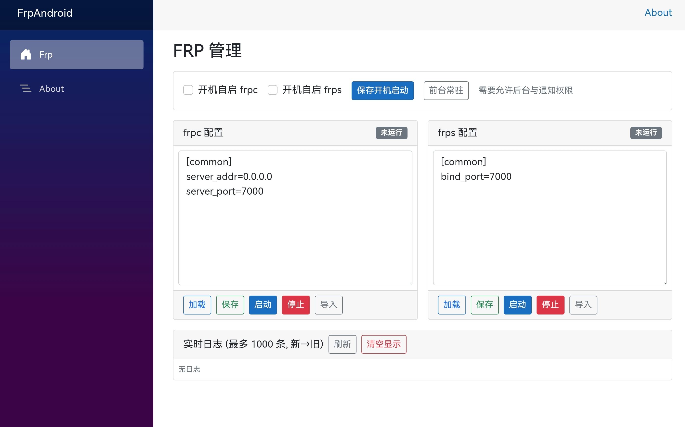

# frp Android Client

[](https://github.com/qiuhaotc/frp_android)
[](https://github.com/qiuhaotc/frp_android)
[](https://github.com/qiuhaotc/frp_android)
[](https://github.com/qiuhaotc/frp_android/releases)
[](https://github.com/qiuhaotc/frp_android/releases)
[](https://github.com/qiuhaotc/frp_android)

English | [中文文档](README.md)

A lightweight .NET MAUI Android app to run and manage frp (both frpc & frps) directly on a phone / TV box.



## Features

- Start / stop frpc and frps (downloaded and bundled at build time; no runtime download; see release notes for the frp version)
- Auto-generate default `frpc.toml` / `frps.toml` on first launch
- In-app config editing & saving
- Real-time log view (ANSI colors / control chars stripped)
- Foreground service to reduce process killing
- No root, small footprint, clean UI

## Quick Start

1. Install & open the app
2. First launch writes default `frpc.toml` / `frps.toml`
3. Edit configs in-app (e.g. expose an intranet service)
4. Start frpc or frps and watch logs to verify

Stop: tap the corresponding stop button. Force closing / system cleanup will terminate tunnels.

## Build

Requirements:

- .NET 10+ (targets include `net10.0-android`)
- MAUI Android workload: `dotnet workload install maui-android`
- Android SDK / build tools (via Visual Studio or CLI)
- PowerShell (built-in Windows PowerShell 5.1 on Windows, PowerShell 7 on other systems) and `tar`
- Access to the GitHub API and release downloads; set `GITHUB_TOKEN` or `GH_TOKEN` if API rate limits are reached

Build from the repository root (Release example, using the existing signing environment variables and keystore):

```powershell
dotnet build src/FrpAndroid.csproj -c Release -f net10.0-android
```

Every actual Android build first checks the [latest stable frp release](https://github.com/fatedier/frp/releases), excluding drafts and prereleases. The downloader maps `android_arm64` to `arm64-v8a` and `linux_arm` to `armeabi-v7a`, verifies archive SHA-256 hashes against `frp_sha256_checksums.txt`, checks the ELF architectures, and renames the programs to `libfrpc.so` / `libfrps.so`.

The four libraries and their checksum manifest are cached in `src/obj/frp/<version>/`. Verified files for the same version are reused, but release metadata is still checked online. Lookup, download, checksum, or extraction failures stop the build; there is no fallback to an older version. IDE design-time evaluation and standalone `dotnet restore` do not download frp. Normal builds and the local publishing script use the preparation target automatically.

To pin frp for a reproducible build:

```powershell
dotnet build src/FrpAndroid.csproj -c Release -f net10.0-android -p:FrpVersion=0.71.1
```

Pinned builds still verify the release online. The selected release must include both `android_arm64` and `linux_arm` archives plus `frp_sha256_checksums.txt`; older releases missing these assets cannot use this build flow. Use `-p:FrpPowerShell=pwsh` to select PowerShell 7, or `-p:FrpCacheDirectory=<path>` to change the cache location. The APK bundles the binaries and never downloads them at runtime.

### Automated Releases

The [Android Release workflow](.github/workflows/release-android.yml) checks weekly on Monday at 03:00 UTC (11:00 China Standard Time). Edit `schedule.cron` to change the frequency. Scheduled workflows run only on the default branch and may be delayed; GitHub may also disable schedules in inactive public repositories.

- The application prefix comes from the highest numeric version in published stable release tags, ignoring drafts and prereleases. Both ordinary and combined tags are supported. Automatic tags use `v<application-version>-frp<frp-version>`: an existing `v2.0.1` yields `v2.0.1-frp0.71.1`. The project display version is used only when no usable release history exists.
- An already released version skips downloads and APK builds. Lookup failures fail the workflow rather than being treated as "no update". The resolved version is pinned throughout the build.
- Manual dispatch with an empty `version` checks for updates. Set `version` to a release tag such as `v2.0.2` to publish application changes even when frp has not changed. Optional `frp_version` pins a stable frp release; an empty value selects the latest stable version.
- Ordinary `v*` tag pushes still publish application releases. Combined `v*-frp*` tags are excluded to prevent automatic releases from triggering another build. Existing releases are never overwritten, and an existing tag must point to the selected source commit.
- The APK display version stays in the project; release `versionCode` is the workflow run number plus one. Keep the workflow name and existing signing key to preserve upgrade compatibility. Local builds do not automatically increment this code.
- Files are uploaded before the release is automatically made public. Failed uploads attempt to remove this run's draft. Releases include `frp-binaries.json` with the source commit, frp version, and archive/library checksums. The pipeline verifies all four libraries in the APK against the downloaded payload.

Configure the existing signing secrets under **Settings > Secrets and variables > Actions**:

| Secret | Value |
| --- | --- |
| `ANDROID_KEYSTORE_B64` | Base64 of the existing production keystore |
| `ANDROID_KEYSTORE_PASS` | Keystore password |
| `ANDROID_KEY_ALIAS` | Signing key alias |
| `ANDROID_KEY_ALIAS_PASS` | Signing key password |

Any missing value stops public release creation; temporary debug signing is not used. Actions supplies `GITHUB_TOKEN` automatically. The publishing job requires repository contents write permission.

### Stop Tracking Legacy Binaries

Builds no longer read the old `.so` files under `Resources/Raw`, and ignore rules have been added. For already tracked files, `.gitignore` does not remove them from the index. Run once from the repository root:

```powershell
git rm --cached --ignore-unmatch -- src/Resources/Raw/arm64-v8a/libfrpc.so src/Resources/Raw/arm64-v8a/libfrps.so src/Resources/Raw/armeabi-v7a/libfrpc.so src/Resources/Raw/armeabi-v7a/libfrps.so
```

This preserves local files and stops tracking them in the next commit, without rewriting existing history. Binaries in older commits remain there.

## Structure

```text
build/
  Get-FrpBinaries.ps1       # Shared downloader and checksum verification
src/
  Platforms/Android/        # Foreground service & entry Activity
  Services/                 # Runtime management logic
  Resources/Raw/            # Other raw assets; no build-time frp libraries
  obj/frp/                  # Generated versioned binary cache (not in Git)
  Components/Pages/         # .NET MAUI / Razor UI
```

## Notes

- Default configs are examples: harden & adjust before exposing services publicly
- System battery / background limits may still terminate the process

## Roadmap (potential)

- Simple graphical config wizard
- Multiple config profiles / templates
- Keep-alive & scheduled restart

## License

Apache License 2.0 (see `LICENSE.txt`).

## Contributing

Issues & PRs are welcome.

---

frp itself belongs to its upstream project; this app only provides a local management UI.
